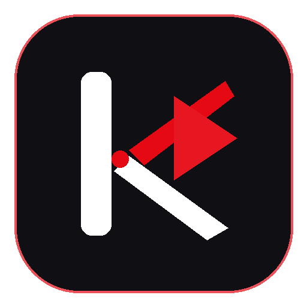

# KEIOL

  
  <h2>KEIOL Video Player</h2>
  
<strong>Pemutar Video Desktop Modern dengan Kontrol Khas YouTube & Hub Streaming Anime</strong>

  

    
  

  

    
    
    
  

---

## 📥 Cara Download dan Install (Windows)

Menginstall KEIOL di komputer atau laptop Windows sangat mudah:

1. **Unduh File Instalasi**:
   Buka halaman rilis terbaru di [Halaman Download KEIOL](https://github.com/Xeranov/KEIOL/releases/latest), lalu unduh file bernama **`KEIOL-Setup-x.x.x.exe`**.
2. **Jalankan Installer**:
   Klik dua kali pada file `.exe` yang baru saja diunduh.
3. **Ikuti Panduan di Layar**:
   Pilih lokasi folder pemasangan dan klik **Install**. Shortcut KEIOL akan otomatis muncul di Desktop dan Start Menu Anda.
4. **Selesai**:
   Buka KEIOL dan aplikasi langsung siap memutar video apa pun!

> [!TIP]
> **Catatan Windows SmartScreen**:
> Jika Windows menampilkan jendela *"Windows protected your PC"* saat pertama kali membuka installer, klik teks **"More info"** (Info selengkapnya), lalu klik tombol **"Run anyway"** (Tetap jalankan). Hal ini normal untuk aplikasi baru yang belum memiliki sertifikat komersial berbayar.

---

## 📸 Tampilan Antarmuka (Preview)

> Letakkan gambar tangkapan layar tampilan KEIOL Anda di sini:

*(Tampilan antarmuka gelap yang nyaman untuk mata, dengan tata letak modern bergaya galeri serial dan pemutar video YouTube).*

---

## ✨ Fitur & Cara Kerja Sistem KEIOL

### 1. Putar Segala Format Video Tanpa Ribet
Anda tidak perlu lagi menginstall codec pihak ketiga. KEIOL sudah dibekali mesin pemutar video canggih (FFmpeg) bawaan yang mampu memutar semua jenis video secara mulus:
- **Format yang Didukung**: MKV, MP4, AVI, WEBM, MOV, TS, FLV, dan lainnya.
- **Kualitas Tinggi**: Mampu memutar video anime 10-bit (Hi10P), resolusi 4K, hingga audio surround 5.1 tanpa jeda atau layar hitam.
- **Subtitle Lengkap**: Mendukung subtitle bawaan di dalam video maupun file eksternal (.srt, .vtt, .ass) dengan penataan gaya yang rapi.

### 2. Kontrol Playback Khas YouTube
Menonton video terasa sangat alami dan cepat:
- **Akselerasi 2x Instan (Hold-to-Boost)**: Tahan tombol `Spasi` pada keyboard atau tahan `Klik Kiri` mouse di layar video untuk mempercepat putaran menjadi 2x. Lepaskan untuk kembali ke kecepatan normal.
- **Lompat Waktu (Seeking)**: Tekan tombol `J` untuk mundur 10 detik, atau `L` untuk maju 10 detik (bisa juga menggunakan tombol panah kiri / kanan).
- **Layar Penuh (Fullscreen)**: Klik dua kali (*double-click*) pada layar video untuk masuk atau keluar dari mode layar penuh (atau tekan tombol `F`).
- **Episode Selanjutnya**: Tekan `Shift + N` untuk langsung berpindah ke episode berikutnya.
- **Atur Kecepatan Bebas**: Atur kecepatan putar dari sangat lambat (0.25x) hingga super cepat (4.0x) dengan shortcut `Shift + >` dan `Shift + <`.
- **Cek Detil Frame demi Frame**: Saat video sedang di-pause, tekan tombol titik `.` untuk maju satu frame, atau koma `,` untuk mundur satu frame.

### 3. Pengatur Ukuran Tampilan (Zoom Layar)
Sama seperti di browser web, Anda bisa menyesuaikan skala antarmuka KEIOL dengan sangat fleksibel:
- **Perbesar Layar (Zoom In)**: Tekan **`Ctrl + +`** atau **`Ctrl + =`** (bisa langsung ditekan tanpa perlu tombol Shift).
- **Perkecil Layar (Zoom Out)**: Tekan **`Ctrl + -`**.
- **Kembalikan Normal (100%)**: Tekan **`Ctrl + 0`**.
- **Zoom Cepat**: Tahan tombol `Ctrl` lalu gulirkan roda mouse (*mouse wheel*) ke atas atau ke bawah.

### 4. Berjalan di Latar Belakang (Windows System Tray)
Ketika Anda sedang memutar lagu atau mengunduh episode anime, Anda bisa menutup jendela aplikasi tanpa memutus suaranya:
- Saat tombol silang `(X)` diklik, KEIOL akan otomatis mengecil ke area notifikasi di pojok kanan bawah taskbar Windows (System Tray).
- Klik icon KEIOL di pojok kanan bawah untuk membuka kembali jendela aplikasi.
- Klik kanan pada icon tray untuk menu instan: *Buka KEIOL*, *Putar / Jeda*, *Buka Pengaturan*, atau *Keluar*.
- *Ingin tombol (X) langsung mematikan aplikasi?* Anda bisa mengubahnya kapan saja melalui menu **Pengaturan** di dalam aplikasi.

### 5. Sistem Update Otomatis & Pembaruan Darurat
Anda tidak perlu repot mengecek situs web secara manual untuk mendapatkan fitur baru:
- **Notifikasi Otomatis**: Setiap kali aplikasi dibuka, KEIOL akan memeriksa rilis terbaru secara otomatis di latar belakang.
- **Pilihan Fleksibel**: Saat ada versi baru, popup rilis akan muncul beserta ringkasan pembaruan. Anda bisa memilih:
  - **Update Sekarang**: Aplikasi langsung mengunduh versi terbaru dan siap dipasang.
  - **Nanti Saja**: Tutup pemberitahuan jika Anda sedang sibuk menonton, dan aplikasi akan mengingatkan kembali saat dibuka nanti.
  - **Lewati Versi Ini**: Jika Anda tidak ingin memperbarui ke versi tersebut, pilih lewati dan notifikasi tidak akan mengganggu Anda lagi untuk nomor versi itu.
- **Sistem Perlindungan Darurat (Force Update)**: Jika terjadi kesalahan teknis atau bug kritis pada versi tertentu, sistem akan menampilkan pemberitahuan pembaruan wajib demi keamanan dan kenyamanan pengguna.

### 6. Galeri & Streaming Anime
Bagi penggemar anime, KEIOL menyediakan tab khusus untuk menonton dan mengunduh anime:
- **Jadwal & Sedang Tayang**: Pantau episode terbaru yang rilis setiap harinya.
- **Lewati Lagu Pembuka (AniSkip)**: Cukup tekan tombol **`S`** pada keyboard untuk langsung melompat melewati intro lagu opening anime tanpa perlu menggeser slider secara manual.
- **Download Manager**: Unduh episode favorit untuk ditonton secara offline saat bepergian.

---

## ⌨️ Daftar Tombol Pintasan Cepat (Keyboard Shortcuts)

| Tombol Pintasan | Fungsi |
|---|---|
| `Spasi` atau `K` | Putar / Jeda video (Play / Pause) |
| **Tahan `Spasi`** / **Tahan Klik Mouse** | **Akselerasi 2x Lipat Cepat (Hold-to-Boost)** |
| `J` atau `Panah Kiri` | Mundur 10 detik |
| `L` atau `Panah Kanan` | Maju 10 detik |
| `Panah Atas` / `Panah Bawah` | Tambah / Kurangi volume suara sebesar 5% |
| `M` | Matikan suara / Senyap (Mute) |
| `F` | Masuk / Keluar layar penuh (Fullscreen) |
| `I` | Mode Miniplayer (Picture-in-Picture) |
| `C` | Hidupkan / Matikan subtitle |
| `S` | Lewati intro pembuka anime (AniSkip) |
| `Shift + >` / `Shift + <` | Tambah / Kurangi kecepatan putar (+0.25x hingga 4x) |
| `Shift + N` | Lompat ke episode selanjutnya (Next Episode) |
| `0` sampai `9` | Lompat ke 0% hingga 90% durasi video |
| `.` / `,` | Lompat maju / mundur satu frame (saat video dijeda) |
| `Ctrl + O` | Buka file video dari komputer |
| `Ctrl + +` atau `Ctrl + =` | Perbesar tampilan aplikasi (Zoom In) |
| `Ctrl + -` | Perkecil tampilan aplikasi (Zoom Out) |
| `Ctrl + 0` | Kembalikan ukuran tampilan ke ukuran normal (100%) |
| `Ctrl + Scroll Mouse` | Perbesar / perkecil tampilan dengan roda mouse |
| `?` | Buka menu bantuan pintasan keyboard |
| `Esc` | Tutup dialog / keluar dari menu |

---

## ❓ Pertanyaan yang Sering Diajukan (FAQ)

**Q: Apakah KEIOL gratis?**  
A: Ya, KEIOL sepenuhnya gratis untuk digunakan.

**Q: Apakah saya bisa memutar video offline tanpa internet?**  
A: Tentu saja! Anda bisa memutar semua file film atau video pribadi yang tersimpan di harddisk komputer Anda tanpa memerlukan koneksi internet sama sekali.

**Q: Bagaimana cara memasukkan subtitle sendiri?**  
A: Anda bisa menekan tombol **Subtitle** di bilah atas aplikasi, atau langsung menarik (*drag-and-drop*) file `.srt` atau `.ass` dari folder komputer Anda ke atas layar video.

**Q: Kenapa jendela aplikasi tidak tertutup saat saya menekan tombol X?**  
A: Secara default, KEIOL mengecil ke System Tray di pojok kanan taskbar agar video/musik atau proses download Anda tidak terhenti. Jika Anda ingin tombol X langsung menutup aplikasi total, buka tab **Pengaturan** di dalam aplikasi dan nonaktifkan opsi *"Minimalkan ke System Tray saat tombol Tutup (X) diklik"*.

**Q: Bagaimana cara keluar total dari aplikasi jika ada di System Tray?**  
A: Klik kanan pada icon KEIOL di pojok kanan bawah taskbar Windows, lalu pilih **Keluar**.

---

  
Dibuat dengan ❤️ oleh <a href="https://github.com/Xeranov">Xeranov</a>

